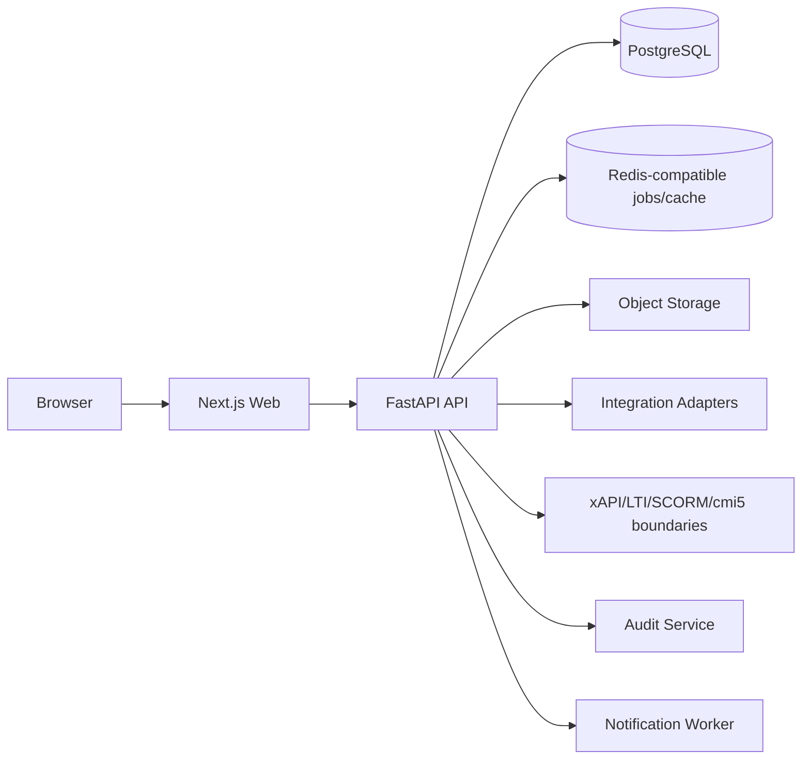
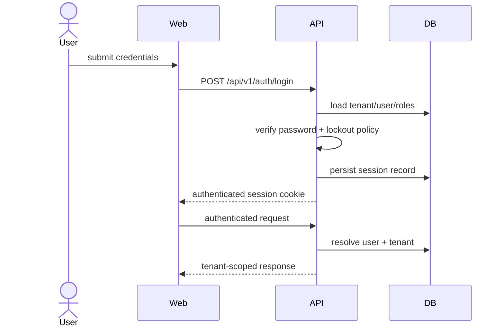
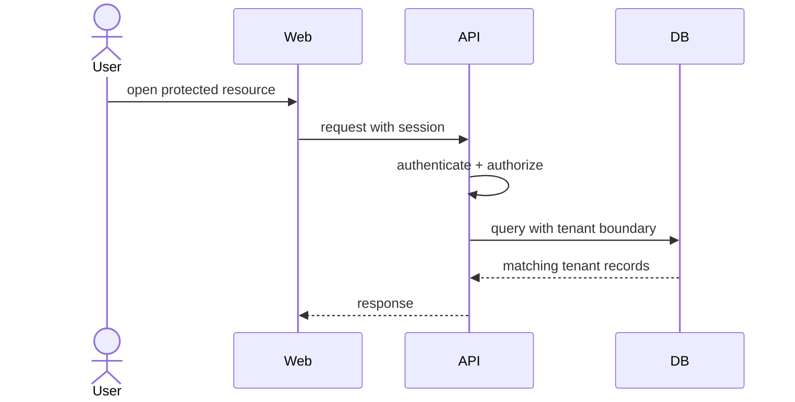
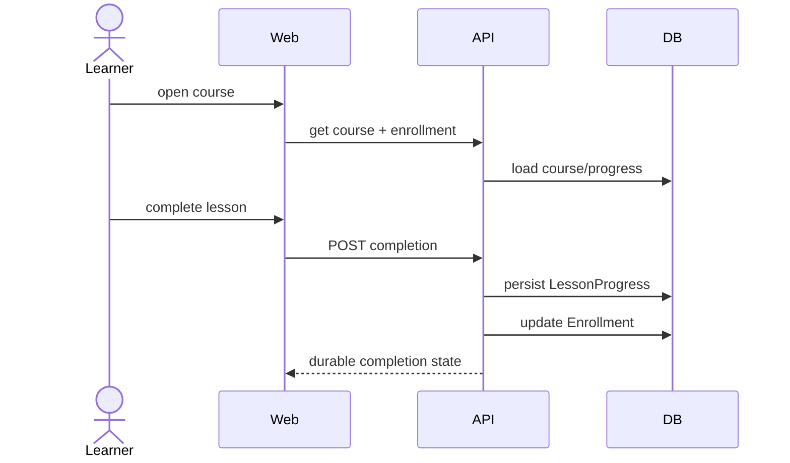
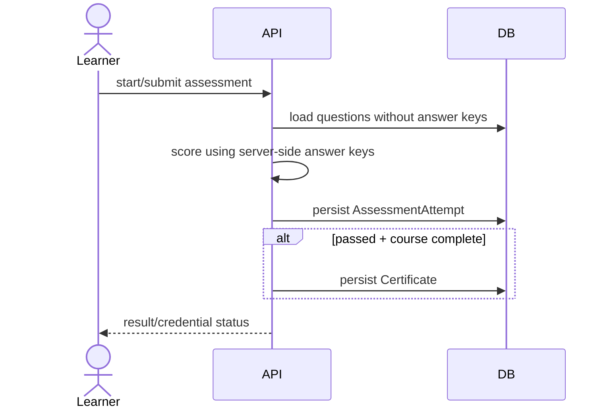
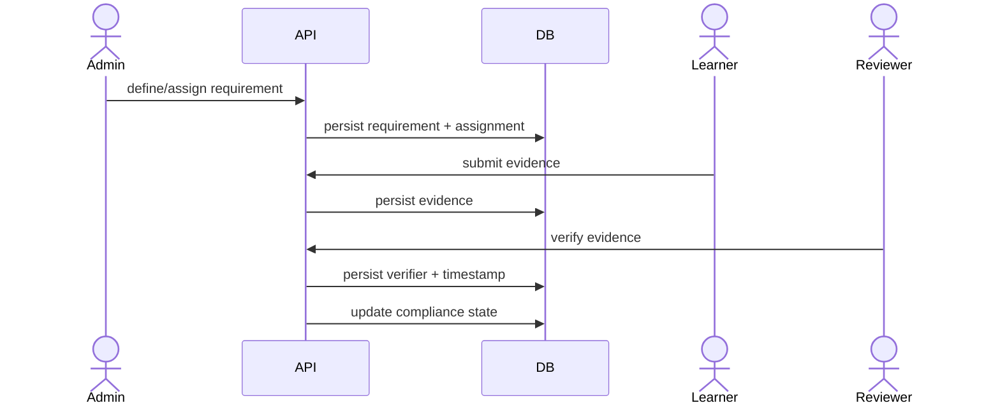
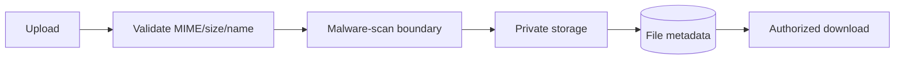

# Corporate LMS — Architecture and Critical Sequences

Version: 0.1
Status: Phase 0 baseline

## 1. Logical architecture

## 2. Login / session sequence

## 3. Tenant-scoped read

## 4. Learning completion

## 5. Assessment and certificate

## 6. Compliance evidence

## 7. File lifecycle

These diagrams are normative at Phase 0; implementation changes require architecture/ADR review where the trust boundary changes.